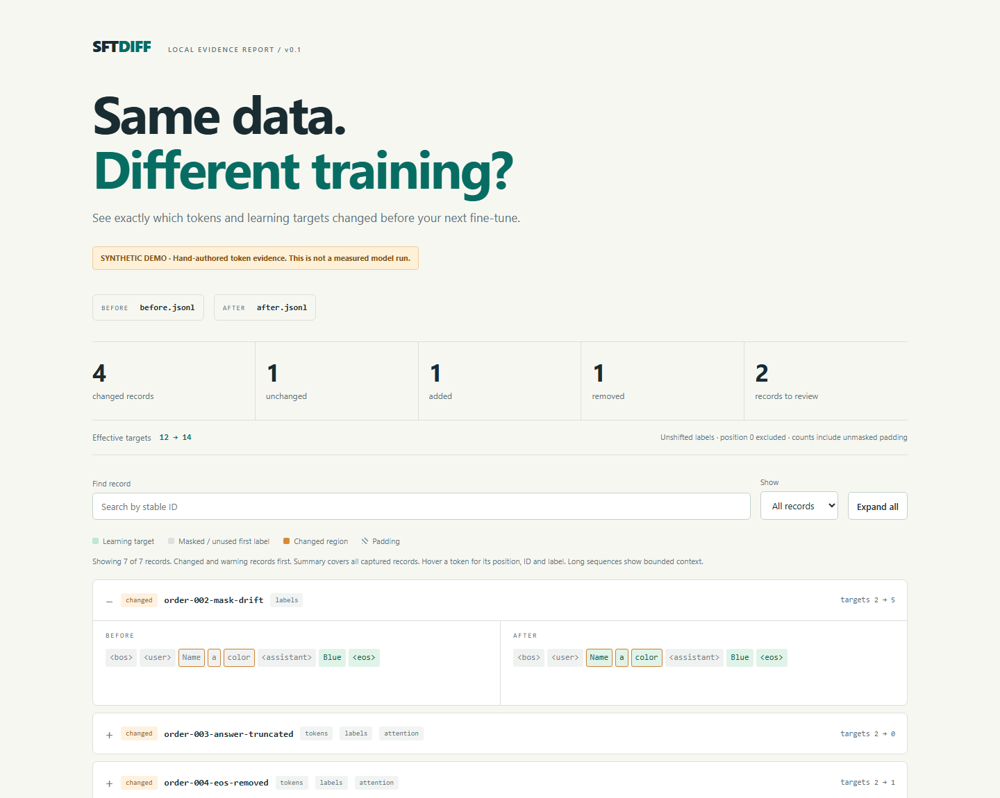

# SFTDiff

**See what changed in the tokens your fine-tune learns from.**

Compare actual tokenized training inputs and labels across two pipeline runs. Get a standalone HTML report and a CI exit code. No model weights, GPU, API key, web server, or runtime dependencies required by the comparison tool.

**Status: working alpha.** The included demo is synthetic. This project has not yet been validated across a matrix of training frameworks. [Türkçe](README.tr.md) · [Snapshot format](FORMAT.md)



## Try it

From a checkout, Python 3.10+:

```sh
python -m sftdiff demo --out demo-run
```

Open `demo-run/report.html` in your browser. The demo generates six records per snapshot, covering an unchanged example, mask drift, a truncated answer, a missing EOS token, unmasked padding, and added/removed records.

```text
SFTDiff | training input comparison
  4 changed | 1 unchanged | 1 added | 1 removed
  Effective targets: 12 -> 14
  Records with review warnings: 2
  Differences are evidence, not automatic correctness failures.
```

For the `sftdiff` executable:

```sh
python -m pip install .
sftdiff compare demo/before.jsonl demo/after.jsonl --html comparison.html
```

The checked-in [`demo/report.html`](demo/report.html) can also be opened locally. GitHub's file viewer does not execute it.

## Why this exists

Changing a chat template, training configuration or preprocessing library can change the learning target even when your source dataset stays the same. SFTDiff compares the evidence that reaches the model: `input_ids`, `labels`, and an optional 2D `attention_mask`.

- Rows match by **stable source ID**, so a shuffle alone does not create changes.
- A vocabulary/special-ID fingerprint guards against comparing unrelated token IDs.
- The HTML shows both sequences, supervised positions, padding and changed regions.
- The JSON report retains complete captured rows, opcodes and provenance.
- Comparison never retokenizes the input or guesses labels from message roles.

Differences may be intentional. SFTDiff does not decide that every user token must be masked, infer your training objective, or measure model quality. Masked tokens can still influence gradients through context; the report shows direct target labels, not gradient flow.

## Capture a real batch

Call `capture_batch` **after your actual collator**, with stable IDs in exactly the same order as the batch. It accepts nested lists, NumPy arrays or standard 2D PyTorch tensors without importing those libraries itself.

```python
from sftdiff import capture_batch

# These are the final tensors from YOUR preprocessing/collation path.
batch = your_collator(examples)

capture_batch(
    "before.jsonl",
    batch,
    tokenizer,
    row_ids=[example["id"] for example in examples],
    metadata={
        "pipeline": "baseline",
        "packing": False,
        "template_revision": "record-the-exact-revision-here",
        "max_length": 2048,
    },
)
```

Export `after.jsonl` from your changed pipeline using the same source IDs. The exporter does not hook into a trainer, alter labels, train a model, or fetch a tokenizer. Its tokenizer argument must already be loaded and expose `get_vocab()`, `all_special_ids`, and `convert_ids_to_tokens()`.

Do not use shuffled batch indices as IDs. Propagate IDs alongside each example before collation. Capture each selected batch into its own file in v0.1; passing an existing output path is refused unless `force=True` is explicit.

## Compare and gate changes

```sh
sftdiff compare before.jsonl after.jsonl --html report.html --json evidence.json
sftdiff compare before.jsonl after.jsonl --fail-on-change
sftdiff compare before.jsonl after.jsonl --fail-on-warning
```

| Exit code | Meaning |
| --- | --- |
| `0` | Comparison completed; requested gates passed |
| `1` | A requested change/warning gate failed |
| `2` | Invalid input, incompatible snapshots, CLI error or I/O failure |

By default, changed records are a successful comparison. `--fail-on-change` includes added and removed records. `--fail-on-warning` also considers warnings in unchanged and removed records on either side. Existing reports require `--force`; input snapshots are never permitted as output paths, even with that flag.

HTML defaults to 100 displayed records, prioritizing changes and warnings, and bounded token context per record. Use `--max-rows 200` to increase the record limit. Summary totals and JSON cover every captured record. The tool currently loads snapshots into RAM; it is intended for selected diagnostic samples, not a whole pretraining corpus.

## Boundaries

- **Unpacked, text-only causal-LM samples**, with unshifted labels (`-100` means ignored). Shifted targets and declared packed inputs are rejected. The exporter cannot prove that undisclosed packing did not happen.
- Effective target counts exclude label position 0, matching standard causal next-token shifting. Unmasked padding is counted and flagged, not silently removed.
- Shared token vocabulary and special-ID mapping required. Normalizer, template or segmentation changes can still appear as input differences. The fingerprint is not a full tokenizer/config identity or cryptographic authenticity check.
- Sequence alignment is a display heuristic. Repeated spans may align ambiguously; the tool does not claim recovered source provenance for those spans.
- Optional token strings are vocabulary pieces, not guaranteed reconstructed natural text.
- Metadata is displayed for provenance but does not itself trigger `--fail-on-change`.
- No multimodal token expansion, packed sample boundary reconstruction, attention-matrix inspection, trainer-specific loss reduction, numerical loss, or gradient comparison in v0.1.
- Reports contain the captured training text and metadata. Keep private reports local or redact inputs before sharing. The generated HTML has no external assets or network calls.

## Existing tools and scope

This is not the first tool to inspect training data or masking. [Axolotl](https://docs.axolotl.ai/docs/dataset-formats/index.html) provides token/label debug output. [TrainSight](https://pypi.org/project/trainsight-preflight/) audits inputs and batches. Hugging Face's [Chat Template Playground](https://github.com/huggingface/chat-template-playground) previews template rendering. [AllenAI](https://github.com/allenai/open-instruct/blob/main/docs/olmo3.md) maintains tokenizer comparisons, and a public [Axolotl–Levanter parity harness](https://gist.github.com/penfever/7ccfe7762926e1a33df1bc004bd4ce96) illustrates a concrete comparison workflow.

SFTDiff's experiment is a small, framework-neutral **two-run comparison format and visual report**. It does not claim a novel comparison algorithm or replace those projects. Implementation is independent; linked projects are context, not endorsements.

## Develop

```sh
python -m unittest discover -s tests -v
node --test tests/test_report_ui.cjs
```

Tests cover ID-based matching, causal shift, capture fidelity, malformed snapshots, overwrite protection, exit codes and escaped HTML. A real tensor capture test runs when PyTorch is available, otherwise it is skipped. CI is configured for Windows and Linux on Python 3.10 and 3.13; configuring a workflow is not a claim that hosted CI has already run.

Optional real-tokenizer smoke test:

```sh
python -m pip install ".[hf]"
python hf_example.py --out hf-demo
```

This downloads only tokenizer files for `Qwen/Qwen2.5-0.5B-Instruct`, not model weights. It uses a Hugging Face language-modeling collator and intentionally compares a response-only objective with an all-token objective. Different targets are expected; this demonstrates capture fidelity, not an upstream bug or model-quality improvement.

Local smoke-test result (Windows, Python 3.13.6, Transformers 5.22.1, NumPy 2.5.4): all 3 source records had identical input IDs and different labels; effective targets changed from 35 to 148, with 0 review warnings. This is one intentional-objective test, not cross-framework parity validation.

Useful contributions: a minimized real pipeline mismatch with framework versions, stable sample IDs, tokenizer identity, and expected differences. Share only data you are permitted to publish. The next validation target is a real framework migration with source IDs preserved end to end.

MIT licensed.
